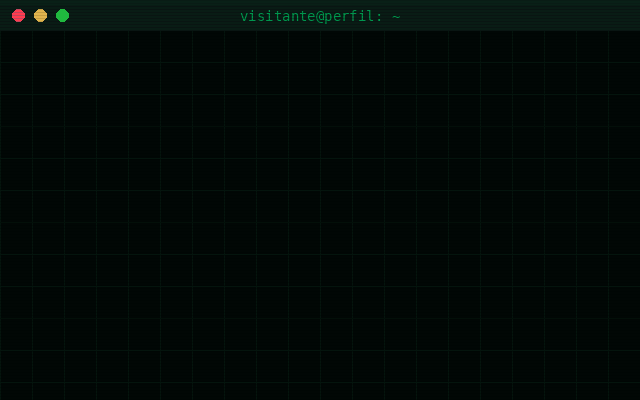

<div align="center">



# Mr. Oliveira

**Engenharia da Computação · Cyber Security · Futuro Engenheiro de Dados**

</div>

---

## `> acesso concedido`

Se você chegou até aqui, a animação acima já mostrou o essencial: no começo o acesso é negado, mas curiosidade e persistência abrem qualquer porta (a minha, pelo menos). Seja bem-vindo!

## Quem sou eu

Sou estudante de Engenharia da Computação e levo a sério a ideia de aprender fazendo. Meu foco é **segurança da informação**, e o objetivo de carreira é me tornar **Engenheiro de Dados**, unindo as duas áreas: dados bem tratados só têm valor quando também estão bem protegidos.

## No que estou focado

- **Cyber Security:** entender como sistemas são atacados para aprender a defendê-los.
- **Dados:** coletar, organizar e transformar informação em algo útil.
- **Programação com Python:** minha ferramenta principal para automatizar, testar ideias e criar projetos.

## Sobre este repositório

A animação do topo foi feita em Python, com a biblioteca [Pillow](https://python-pillow.org/). Ela simula uma tentativa de acesso a um terminal: o acesso é negado, uma "invasão" fictícia acontece (é só visual, nada é invadido de verdade) e, no fim, o perfil é liberado.

Quer gerar a sua? É só editar a seção `CONFIG` do script e rodar:

```bash
pip install pillow
python acessonegado.py
```

O resultado é o arquivo `opa.gif`. Se preferir que a animação toque só uma vez e pare no cartão final, troque `LOOP = True` por `LOOP = False` na mesma seção.

## Vamos conversar?

Gosto de trocar ideia com quem também está aprendendo ou trabalhando com tecnologia, segurança e dados.

- Instagram: [@mt.vky_](https://instagram.com/mt.vky_)

---

<div align="center">

`> sessão encerrada com sucesso_`

</div>
